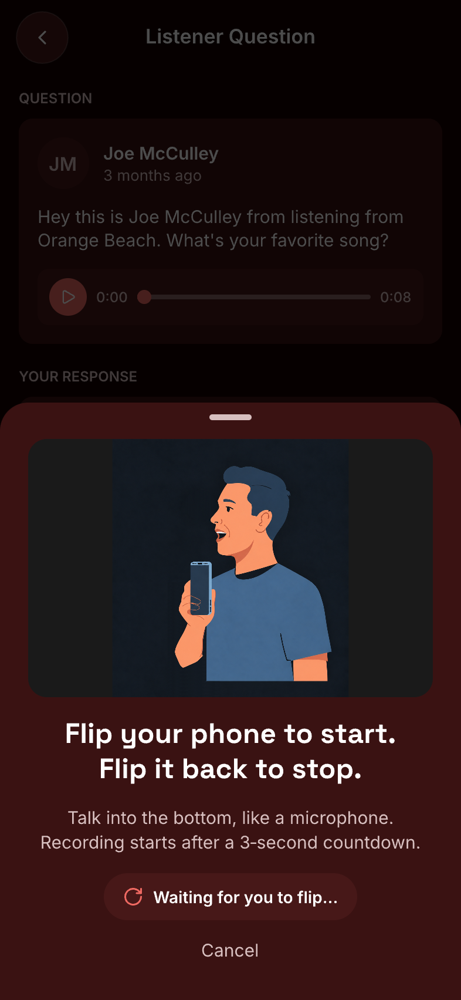
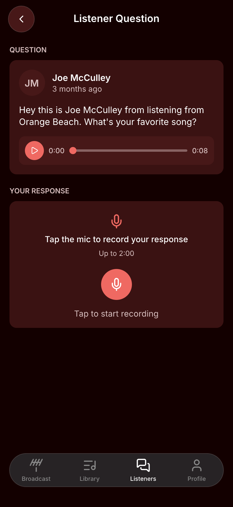
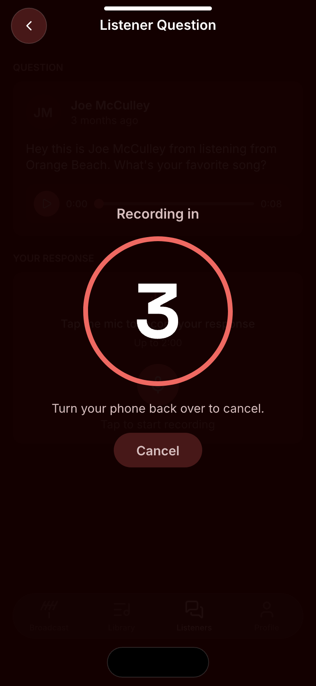
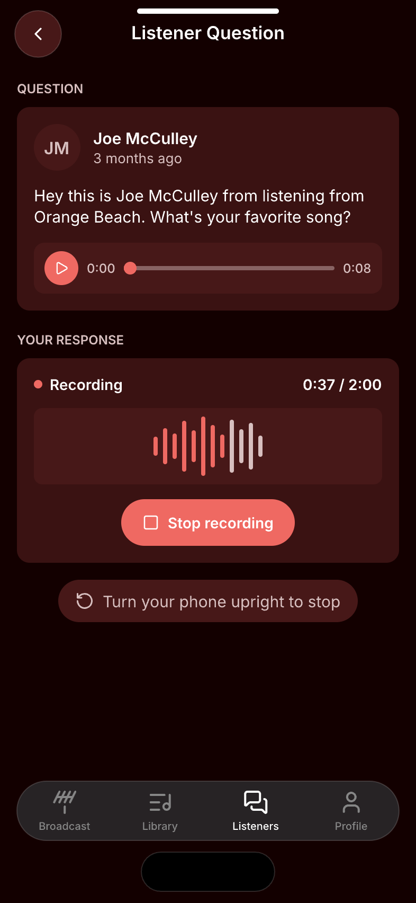

# Flip to record — Screens

Pen file: `design/playola-ios.pen` (zone **Proposal · Flip to Record**)

The mockups use the broadcaster reply screen (`ListenerQuestionDetailPage`) as the example host. The same flow appears on all seven recording screens listed in [spec.md](./spec.md#recording-screens-in-scope-all-seven).

## Navigation map
| Screen | Surface | Address | Reached from |
|---|---|---|---|
| Flip prompt | ios | n/a (native) — sheet over the recording screen | Any recording screen → Record button |
| Recording screen, flipped | ios | n/a (native) — the host recording screen, window rotated 180° | Flip prompt → phone flipped upside down |

## Flip prompt
- **Status:** New
- **Surface:** ios
- **Address:** n/a (native). A bottom sheet presented over the recording screen with a dimmed scrim.
- **Access:** anyone who can open the host recording screen
- **Navigated to from:**
  - Any of the seven recording screens → Record button, when the built-in mic is the active input and the phone is not already upside down
- **Navigates to:**
  - Phone flipped upside down (held ~250 ms) → countdown on the rotated recording screen
  - "Cancel" or tap the scrim → host screen, idle

| State | When it shows | Node | Mockup |
|---|---|---|---|
| Waiting | Prompt is up and the phone has not been flipped. Title: "Flip your phone to start." / "Flip it back to stop." (two equal lines) | `z8wAhd` |  |

## Recording screen, flipped
- **Status:** Changed (applies to all seven recording screens)
- **Surface:** ios
- **Address:** n/a (native). The host recording screen, with the whole window rotated 180° while the phone is held upside down. The speaker sees it right side up; the camera cutout sits at the bottom edge and the home indicator at the top, so the top and bottom safe-area insets swap.
- **Access:** anyone who can open the host recording screen
- **Navigated to from:**
  - Flip prompt → phone flipped upside down
  - Any recording screen → Record button, when the phone is already upside down (prompt skipped)
- **Navigates to:**
  - Countdown finishes → recording starts on the same rotated screen
  - Phone held upright ~1 s while recording, or Stop recording tapped → window rotates back, host screen's existing review state
  - Phone turned upright during the countdown → window rotates back, flip prompt returns
  - Cancel during the countdown → countdown cancelled, window rotates back, host screen returns to idle
  - Leaving the screen during the countdown (nav Back, tab switch, sheet dismiss) → countdown cancelled, window rotates back, recording never starts. The countdown blocks touches on the page itself and has its own Cancel; navigation chrome stays live, and using it cancels the countdown and rotates the window back
- **Changed from today:** recording screens never rotate today, and the Broadcast and AMA screens that do rotate stop rotating (see [spec.md](./spec.md#removed)). Current screen: 

| State | When it shows | Node | Mockup |
|---|---|---|---|
| Countdown | Flip detected; 3-2-1 before recording starts | `gK9Vw` |  |
| Recording | Recording in progress while flipped | `iqEG4` |  |
