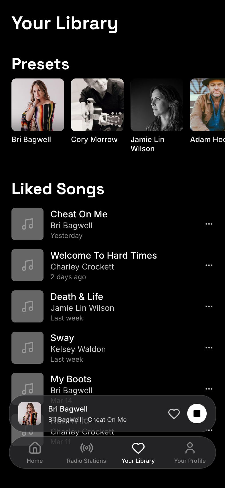
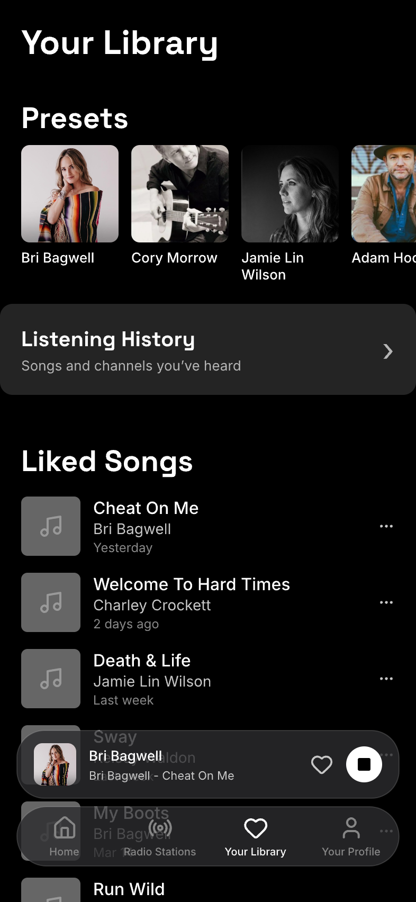
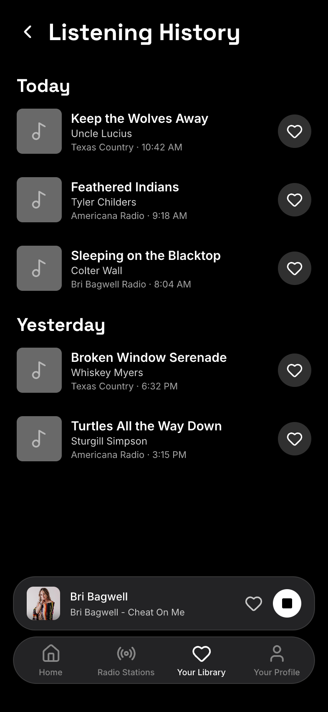
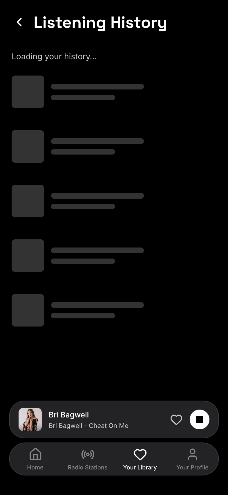
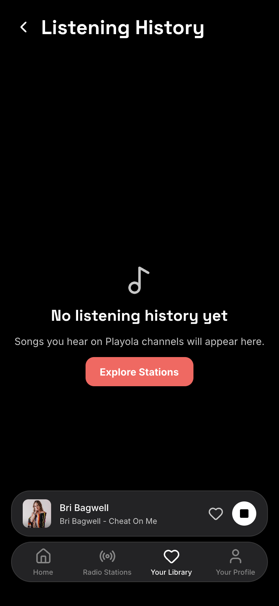
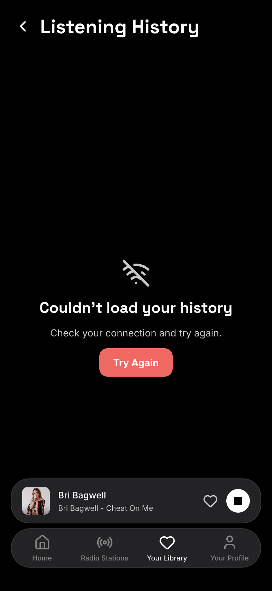
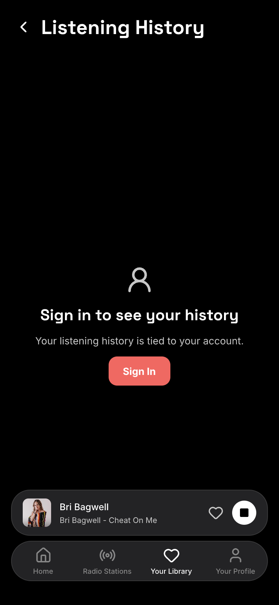
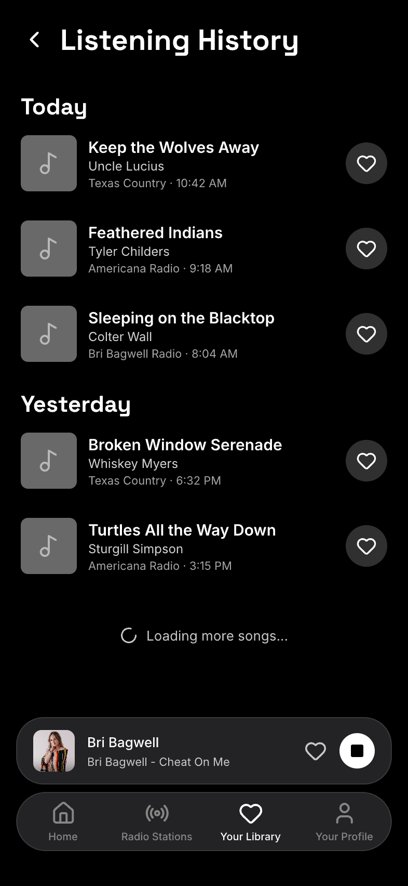
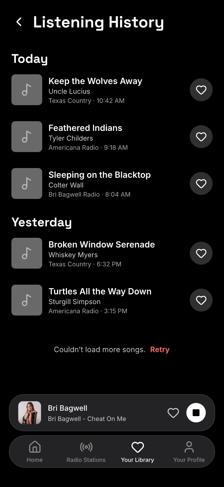

# Song listening history — Screens

Pen file: `design/playola-ios.pen`

The compact Your Library entry and populated detail screen were visually approved on 2026-09-23. The six additional detail states were approved on 2026-11-01. The page displays the existing server history; entering Your Library from another tab refreshes its first page.

## Navigation map

| Screen | Surface | Address | Reached from |
| --- | --- | --- | --- |
| Your Library | ios | n/a (Your Library tab root) | Main tab bar → Your Library |
| Listening History | ios | n/a (pushed onto the Your Library tab stack) | Your Library → compact Listening History entry |

## Your Library

- **Status:** Changed
- **Surface:** ios
- **Address:** n/a (Your Library tab root)
- **Access:** Visible in Your Library while signed in. The app currently shows its Sign In page instead of tabs when signed out.
- **Navigated to from:** Main tab bar → Your Library.
- **Navigates to:** Listening History entry → Listening History detail; other existing Library actions remain available.
- **Changed from today:** Adds one compact Listening History entry between Presets and Liked Songs. Current design: 
- **On entry from another tab:** fetch page one from the existing play-history endpoint and keep it in memory for the detail screen. Returning from the detail or tapping the selected tab does not fetch again. The entry itself has no preview or loading UI.

| State | When it shows | Node | Mockup | Approval |
| --- | --- | --- | --- | --- |
| Default | Your Library is open | `VnLyt` |  | Approved 2026-09-23 |

## Listening History

- **Status:** New
- **Surface:** ios
- **Address:** n/a (pushed onto the Your Library tab stack)
- **Access:** A signed-in listener sees only their own history. If an active pushed page gets 401, it shows the approved sign-in state; the signed-out app root is the existing Sign In page.
- **Navigated to from:** Your Library → compact Listening History entry.
- **Navigates to:** Back → Your Library; Empty state Explore Stations → Radio Stations tab; Signed Out state Sign In → existing sign-out then sign-in flow; song heart → existing Liked Songs action (the existing toast's “View all” can navigate to Liked Songs).

| State | When it shows | Node | Mockup | Approval |
| --- | --- | --- | --- | --- |
| Populated | Songs have been heard | `DageM` |  | Approved 2026-09-23 |
| Initial loading | First history request is in flight | `GNMt9` |  | Approved 2026-11-01 |
| Empty | No qualifying songs in the available history | `Nnpzb` |  | Approved 2026-11-01 |
| Initial error | First history request fails | `W16HKe` |  | Approved 2026-11-01 |
| Signed out | A pushed history page gets 401 because the account expired or was revoked | `kyCIW` |  | Approved 2026-11-01 |
| Loading more | A later page is in flight | `d8xmZF` |  | Approved 2026-11-01 |
| Later page error | A later page fails after rows have loaded | `m5BmO` |  | Approved 2026-11-01 |

The detail list groups server-returned spins by local day. Every populated row shows song, artist, channel and local time; its heart adds or removes that song from Liked Songs. The page reuses a recent or in-flight Library request, refreshes a result older than 60 seconds, loads 20 rows at a time, and keeps loaded rows visible while requesting or retrying a later page. A failed refresh with already loaded rows keeps them on screen and shows a transient error message.
