# Recorded Shows — Screens

Pen file: `design/playola-ios.pen` (zone "Zone · Approved Design · Recorded Shows")

UX words follow spec.md's Vocabulary: **Show** = backend `Episode` (+ its `Airing`), **Series** = backend `Show`.

All pages are pushed onto the Station tab's stack through the navigation coordinator (`.claude/NAVIGATION.md`); all sheets are `PlayolaSheet` cases.

Loading and failure follow the app's existing conventions (no separate mockups): a page loads with the standard progress view; a failed load shows a toast and keeps whatever was shown; a failed action (save, schedule, move, unschedule) shows a `PlayolaAlert` with the server's message and refetches the Show, because the server is the source of truth. Shows with more than one airing (web-made) open read-only and are not offered in any picker.

## Navigation map
| Screen | Surface | Address | Reached from |
|---|---|---|---|
| Station tab | ios | n/a (native) — Station tab root (`ArtistStationPage`) | Tab bar → Station |
| Live (today's Shows, renamed) | ios | n/a (native) — pushed | Station tab → SHOWS "Live" |
| Music / Breakers (renamed) | ios | n/a (native) — pushed | Station tab → LIBRARY "Music" / "Breakers" |
| Upcoming | ios | n/a (native) — pushed | Station tab → SHOWS "Upcoming" |
| Curator Series list | ios | n/a (native) — pushed | Upcoming → "Series" |
| Curator Series page | ios | n/a (native) — pushed | Curator Series list → a card's title |
| Individual Shows | ios | n/a (native) — pushed | Upcoming → "Individual Shows" |
| Show builder | ios | n/a (native) — pushed | Individual Shows → a row or "Record a New Show" · Curator Series list → a Show row in a card · Curator Series page → a Show row · Add a show sheet → "Record a New Show" |
| Add a show sheet | ios | n/a (native) — sheet | Curator Series list → a slot's "+ Add show" · Curator Series page → a slot's "+ Add show" or "Add a Show" |
| Series details sheet | ios | n/a (native) — sheet | Curator Series page → "Edit" · Curator Series list → "Create a New Series" · Series picker sheet → "New Series" |
| Series picker sheet | ios | n/a (native) — sheet | Show builder → the series row |
| Schedule sheet | ios | n/a (native) — sheet | Show builder → "Schedule" or the time's "Change" · Add a show sheet → a Show, when the slot is less than 6 hours away |
| Unschedule confirmation | ios | n/a (native) — sheet | Show builder → "Unschedule" |

## Station tab
- **Status:** Changed
- **Surface:** ios
- **Address:** n/a (native) — Station tab root (`ArtistStationPage`)
- **Access:** station curator (owner/editor)
- **Navigated to from:**
  - Tab bar → Station
- **Navigates to:**
  - SHOWS "Live" → Live
  - SHOWS "Upcoming" → Upcoming
  - LIBRARY "Music" → Music
  - LIBRARY "Breakers" → Breakers
  - On Air Now card → Broadcast (unchanged)
- **Changed from today:** the flat Shows / Music Library / Breakers Library / Schedule list becomes two sections, SHOWS (Live, Upcoming) and LIBRARY (Music, Breakers). The Schedule link is removed; the On Air Now card still opens the station schedule. Today: 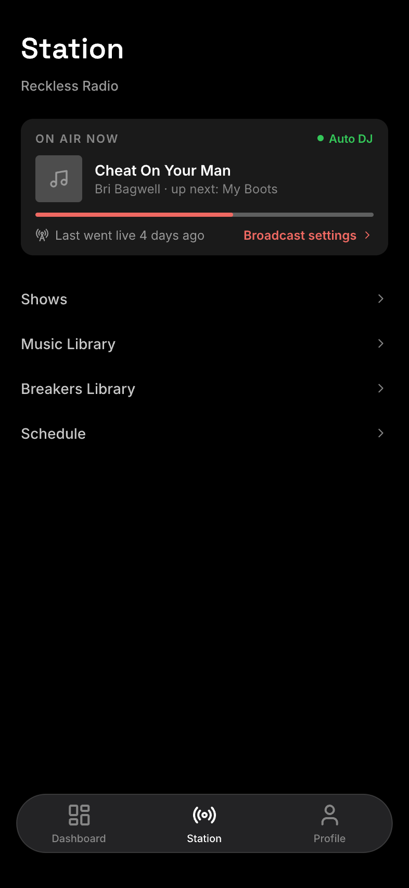

| State | When it shows | Node | Mockup |
|---|---|---|---|
| Default | Always | `j1WFOT` | 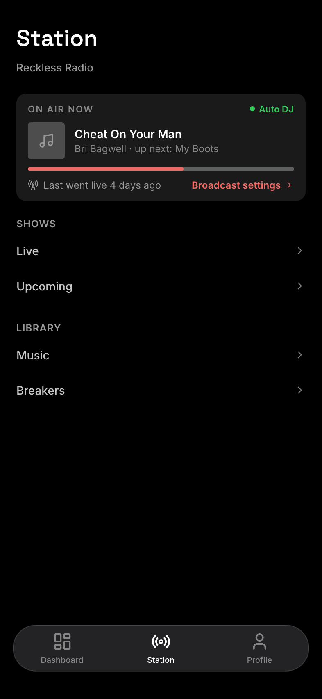 |

## Live, Music and Breakers (renamed)
- **Status:** Changed (title only)
- **Surface:** ios
- **Address:** n/a (native) — pushed onto the Station tab's stack (unchanged)
- **Access:** station curator (unchanged)
- **Navigated to from:**
  - Station tab → SHOWS "Live" (today's `ShowsPage`)
  - Station tab → LIBRARY "Music" (today's `MusicLibraryPage`)
  - Station tab → LIBRARY "Breakers" (today's `BreakersLibraryPage`)
- **Navigates to:** unchanged
- **Changed from today:** navigation titles "Shows" → "Live", "Music Library" → "Music", "Breakers Library" → "Breakers", so each matches the link that opens it. Nothing else changes, so there is no new mockup.

## Upcoming
- **Status:** New
- **Surface:** ios
- **Address:** n/a (native) — pushed onto the Station tab's stack
- **Access:** station curator
- **Navigated to from:**
  - Station tab → SHOWS "Upcoming"
- **Navigates to:**
  - "Series" row → Curator Series list
  - "Individual Shows" row → Individual Shows
  - Back → Station tab

Each row's count line is computed from the station's Series and Shows ("3 series · 3 shows coming up", "6 shows coming up · 1 not scheduled").

| State | When it shows | Node | Mockup |
|---|---|---|---|
| Default | Always | `h2E0tR` | 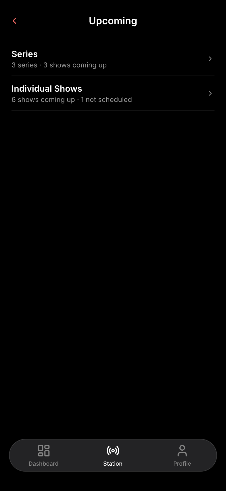 |

## Curator Series list
- **Status:** New
- **Surface:** ios
- **Address:** n/a (native) — pushed onto the Station tab's stack
- **Access:** station curator
- **Title:** "Series" (the navigation title); this is distinct from the listener `seriesListPage` (Radio Shows).
- **Navigated to from:**
  - Upcoming → "Series"
- **Navigates to:**
  - A card's title → Curator Series page
  - A Show row inside a card → Show builder
  - An open slot's "+ Add show" → Add a show sheet (for that slot)
  - "Create a New Series" → Series details sheet (New Series)
  - Back → Upcoming

Each card reuses the listener `SeriesCard`: title, amber repeating-schedule badge, "UPCOMING SHOWS" with counts, then the next Shows and open slots in date order. Hidden one-time Series (standalone Shows) are not listed.

| State | When it shows | Node | Mockup |
|---|---|---|---|
| Default | The station has at least one Series | `A3MYYC` | 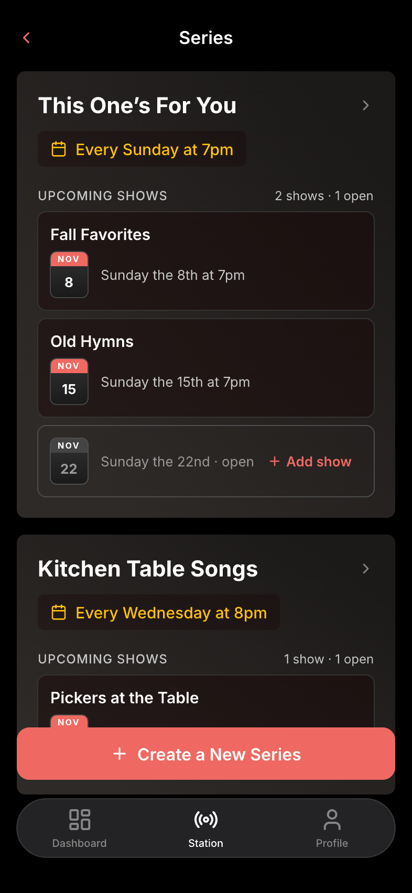 |

## Curator Series page
- **Status:** New
- **Surface:** ios
- **Address:** n/a (native) — pushed onto the Station tab's stack
- **Access:** station curator
- **Navigated to from:**
  - Curator Series list → a card's title
- **Navigates to:**
  - "Edit" → Series details sheet (Edit Series)
  - A Show row (NOT SCHEDULED YET or UPCOMING) → Show builder
  - An open slot's "+ Add show" → Add a show sheet (for that slot)
  - "Add a Show" → Add a show sheet (no slot)
  - Back → Curator Series list

| State | When it shows | Node | Mockup |
|---|---|---|---|
| Default | Always | `sSpLp` | 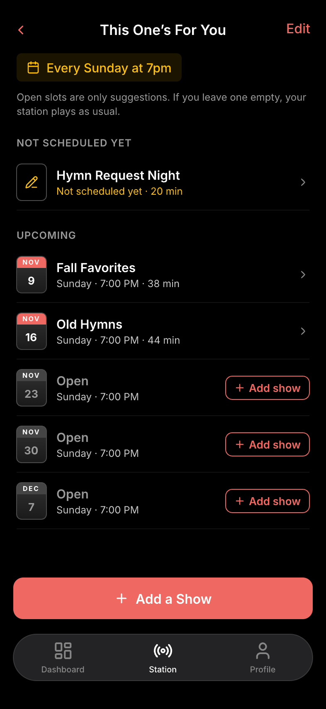 |

## Add a show sheet
- **Status:** New
- **Surface:** ios
- **Address:** n/a (native) — sheet over the Curator Series list or Curator Series page
- **Access:** station curator
- **Navigated to from:**
  - Curator Series list or Curator Series page → an open slot's "+ Add show" (subtitle names the Series and the slot)
  - Curator Series page → "Add a Show" (subtitle names only the Series)
- **Navigates to:**
  - "Record a New Show" → Show builder for a new Show in this Series; from a slot, its Schedule step offers that slot first
  - A listed Show, from a slot → schedules or moves it into the slot, then adds it to this Series; dismisses back with the list refreshed. These are two requests: if adding to the Series fails, an alert says so and the Show stays scheduled at that time outside the Series (fixable from the builder's Series row). If the slot is less than 6 hours away, it opens the Schedule sheet set to that slot first, so its lock note shows.
  - A listed Show, from "Add a Show" (no slot) → adds it to this Series; its air time doesn't change
  - Swipe down → dismiss

Listed: the station's drafts that have at least one piece of audio, and scheduled Shows that are not locked (labeled "Moves here from <old time>"). Locked Shows are not offered.

| State | When it shows | Node | Mockup |
|---|---|---|---|
| Default | Opened from a slot | `kQw4x` | 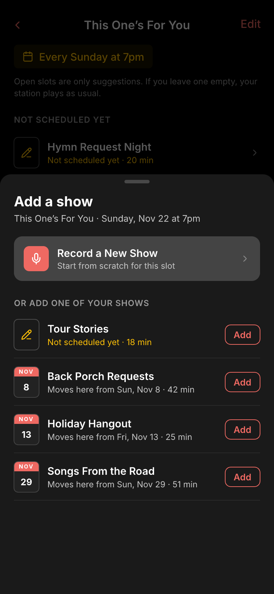 |

## Series details sheet
- **Status:** New
- **Surface:** ios
- **Address:** n/a (native) — sheet
- **Access:** station curator
- **Navigated to from:**
  - Curator Series page → "Edit" (Edit Series)
  - Curator Series list → "Create a New Series" (New Series)
  - Series picker sheet → "New Series" (New Series; on Save the Show joins it)
- **Navigates to:**
  - Save → saves and dismisses (disabled while Name is empty)
  - Cancel or swipe down → dismiss without saving

Repeats: Every week / No schedule. A Series with a rule the app can't edit (made on the website, e.g. every other week) shows that rule's text read-only. Days and Time are hidden when Repeats is "No schedule". Times are in the station's time zone.

| State | When it shows | Node | Mockup |
|---|---|---|---|
| Edit Series | Editing an existing Series | `BRLnN` | 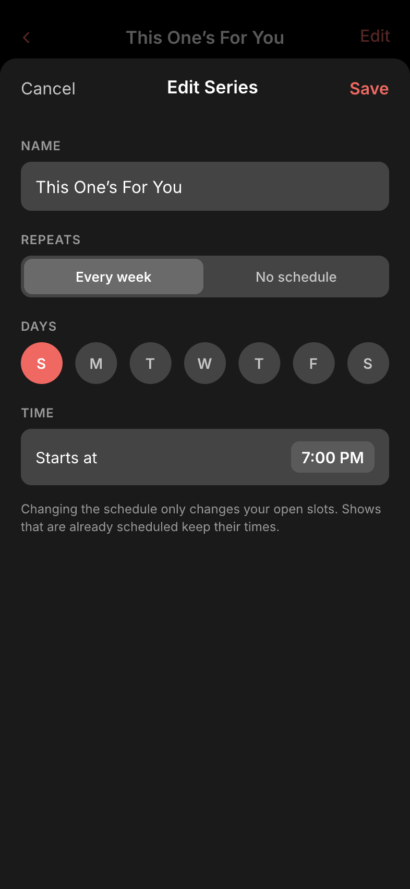 |
| New Series | Creating a Series; Save disabled until it has a name | `YDx8T` | 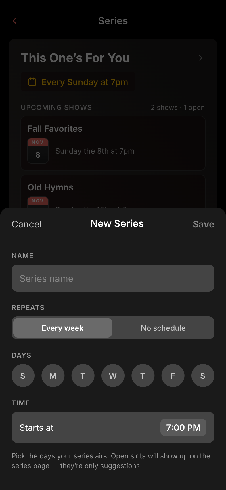 |

## Individual Shows
- **Status:** New
- **Surface:** ios
- **Address:** n/a (native) — pushed onto the Station tab's stack
- **Access:** station curator
- **Navigated to from:**
  - Upcoming → "Individual Shows"
- **Navigates to:**
  - A row → Show builder
  - "Record a New Show" → Show builder (new draft)
  - Back → Upcoming

Every upcoming Show of the station, drafts first (amber pencil tile, "Not scheduled yet"), then scheduled Shows by air time. A Show in a Series carries a grey badge with the Series name.

| State | When it shows | Node | Mockup |
|---|---|---|---|
| Default | The station has drafts or upcoming Shows | `a22564` | 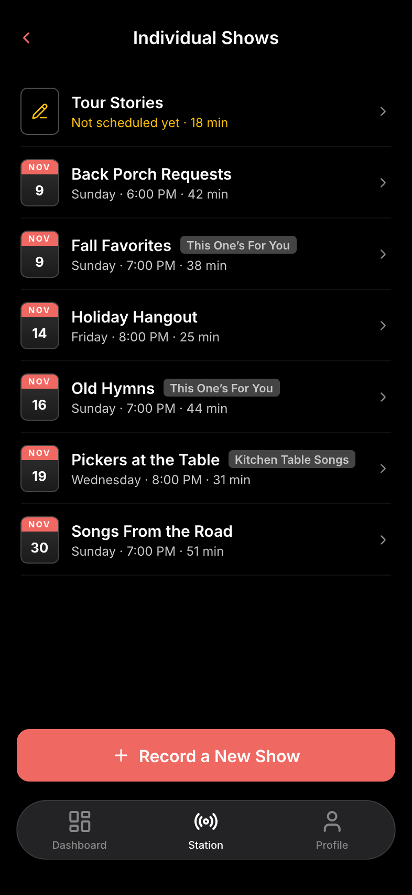 |
| Empty | No drafts and no upcoming Shows | `zsGxw` | 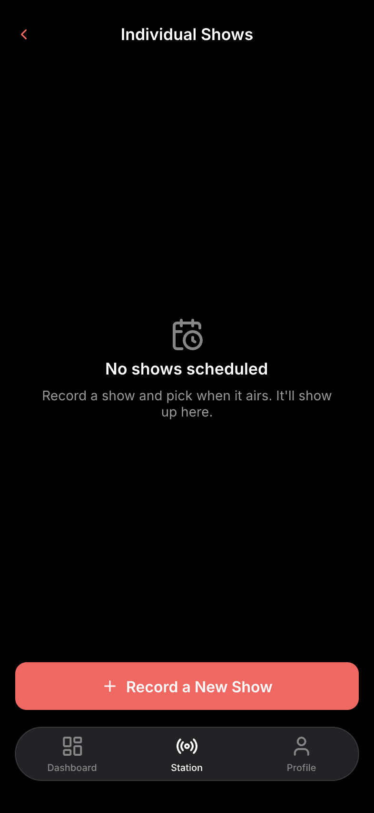 |

## Show builder
- **Status:** New
- **Surface:** ios
- **Address:** n/a (native) — pushed onto the Station tab's stack
- **Access:** station curator
- **Navigated to from:**
  - Individual Shows → a row, or "Record a New Show"
  - Curator Series list → a Show row inside a card
  - Curator Series page → a Show row
  - Add a show sheet → "Record a New Show"
- **Navigates to:**
  - "Rename" → system alert with a text field
  - Series row ("Add to a series" or the Series name) → Series picker sheet
  - Add to Show → Voicetrack recorder / song picker / Q&A picker (reused from the live runner)
  - "Schedule" (draft) or the time's "Change" (scheduled) → Schedule sheet
  - "Unschedule" (Scheduled or Locked) → Unschedule confirmation
  - Back → where it came from

Every change saves as it is made; there is no Save button. A new Show isn't saved until its first change (first piece of content or a rename), so backing out of an untouched builder leaves nothing behind. The 6-hour lock length comes from the server; the builder computes the lock time from the air time. If the lock starts while the builder is open, the next content change is refused with the server's message and the builder switches to Locked. Rename and the Series row work in every state.

| State | When it shows | Node | Mockup |
|---|---|---|---|
| Draft | Not scheduled | `w2AWv` | 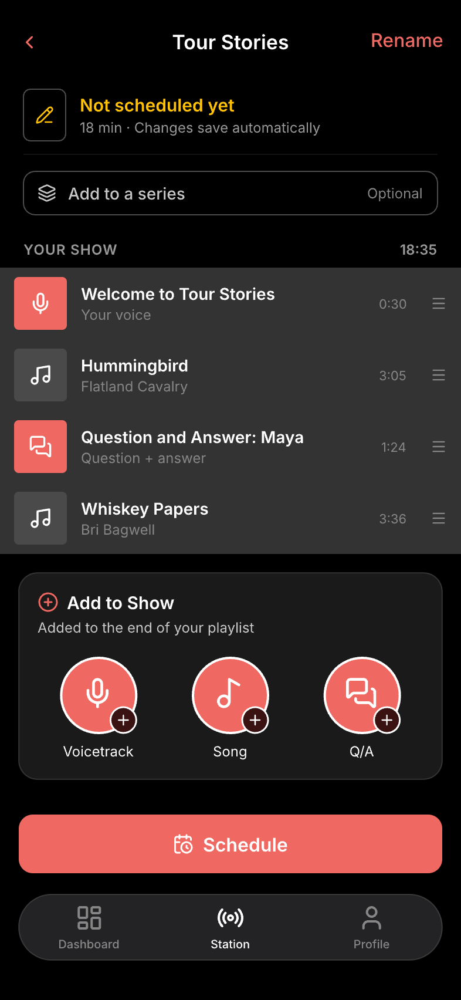 |
| Scheduled | Scheduled, before its edit lock | `k1uRA` | 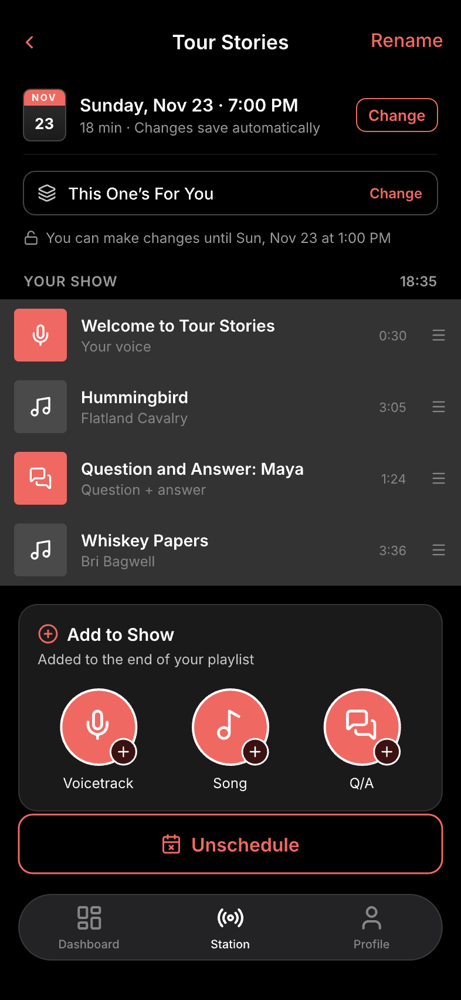 |
| Locked | Inside the edit lock, or on air — content read-only; rename, Series row and Unschedule stay; the status line ("Airs at about 8:02 PM · locked" / "On air now") comes from the model | `ehM5G` | 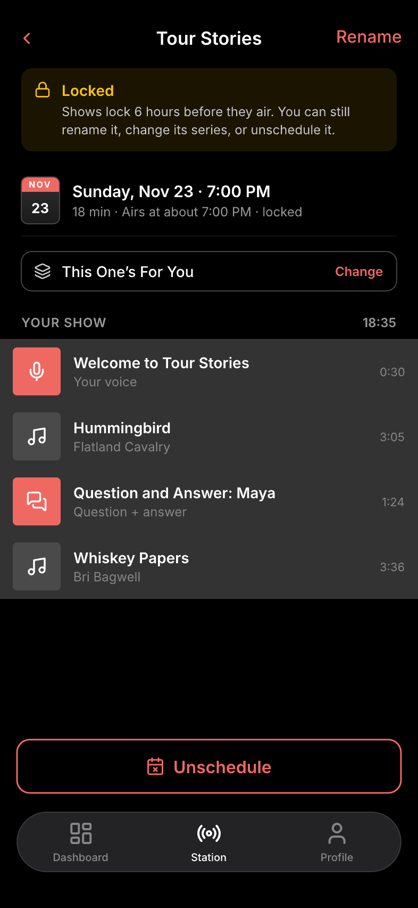 |

## Series picker sheet
- **Status:** New
- **Surface:** ios
- **Address:** n/a (native) — sheet over the Show builder
- **Access:** station curator
- **Navigated to from:**
  - Show builder → the series row
- **Navigates to:**
  - A Series → the Show joins it; dismiss (the Show's air time does not change)
  - "New Series" → Series details sheet (New Series)
  - "Remove from <Series>" → the Show becomes standalone; dismiss
  - Swipe down → dismiss

| State | When it shows | Node | Mockup |
|---|---|---|---|
| Add to a series | The Show is standalone | `WNwOi` | 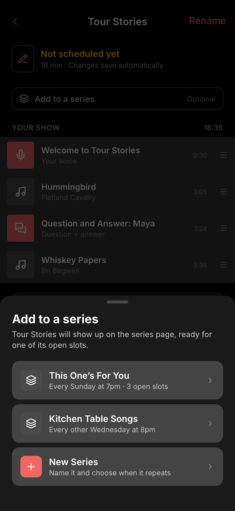 |
| Change series | The Show is in a Series (checked), with Remove | `oEVSa` | 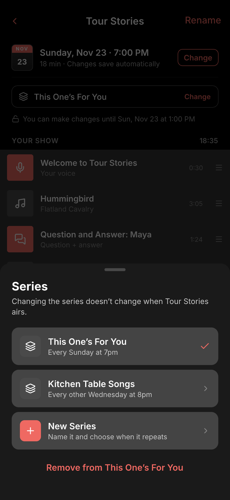 |

## Schedule sheet
- **Status:** New
- **Surface:** ios
- **Address:** n/a (native) — sheet over the Show builder or the Add a show sheet
- **Access:** station curator
- **Navigated to from:**
  - Show builder → "Schedule" (draft) or the time's "Change" (scheduled)
  - Add a show sheet → a Show, when the slot is less than 6 hours away (picker set to that slot)
- **Navigates to:**
  - An open slot → fills the date/time picker with it (doesn't schedule yet)
  - "Schedule" → schedules (or moves) the Show and dismisses; the builder shows the server's air time
  - Cancel or swipe down → dismiss

Top to bottom: the Series' next 8 open slots (only when the Show is in a Series with a weekly schedule), a date/time picker, "Airs at about <time> · ends about <time>" (the picked time and the Show's length), the "Locks right away" note when the picked time is less than 6 hours away, the server's refusal in red, and "Schedule". The server is the judge of overlaps: after any refusal, "Schedule" stays disabled until the day or time changes.

| State | When it shows | Node | Mockup |
|---|---|---|---|
| Series open slots | The Show is in a Series with open slots | `MR1L0` | 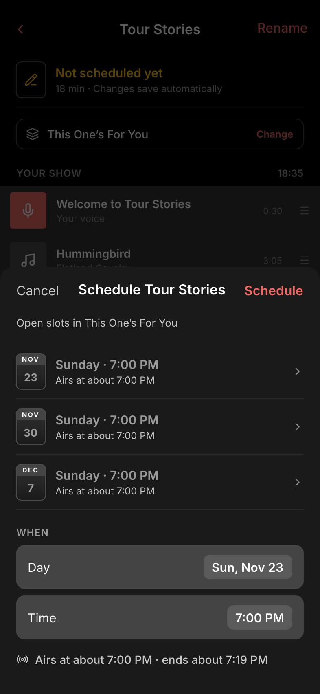 |
| Locks right away | Picked time is less than 6 hours away | `W9gPzv` | 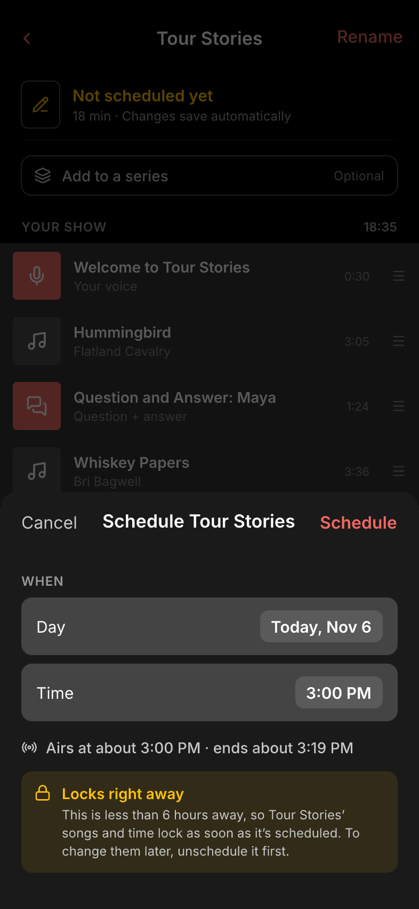 |
| Overlap | The server refused the time because it overlaps another Show, live show or giveaway | `oEDNA` | 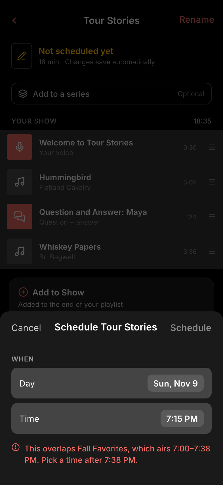 |

## Unschedule confirmation
- **Status:** New
- **Surface:** ios
- **Address:** n/a (native) — sheet over the Show builder
- **Access:** station curator
- **Navigated to from:**
  - Show builder → "Unschedule" (Scheduled or Locked)
- **Navigates to:**
  - "Unschedule" → removes the airing, the Show returns to Draft (a Series slot reopens); dismiss. Inside the server's 2-minute cutoff or once on air, the server's message shows instead.
  - "Keep it scheduled" or swipe down → dismiss

| State | When it shows | Node | Mockup |
|---|---|---|---|
| Default | Unschedule tapped | `Y0yMwW` | 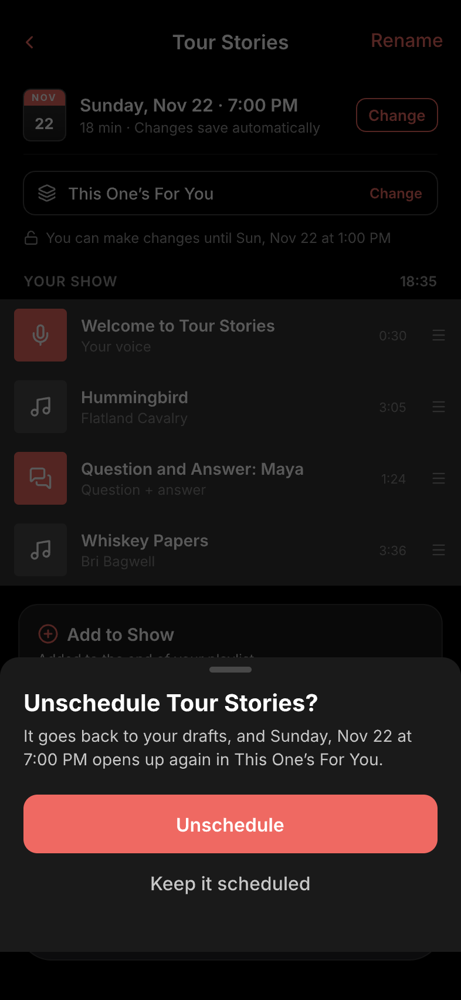 |
