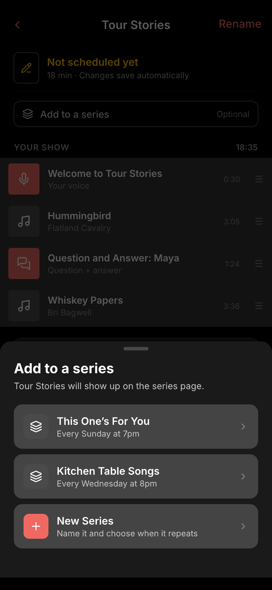
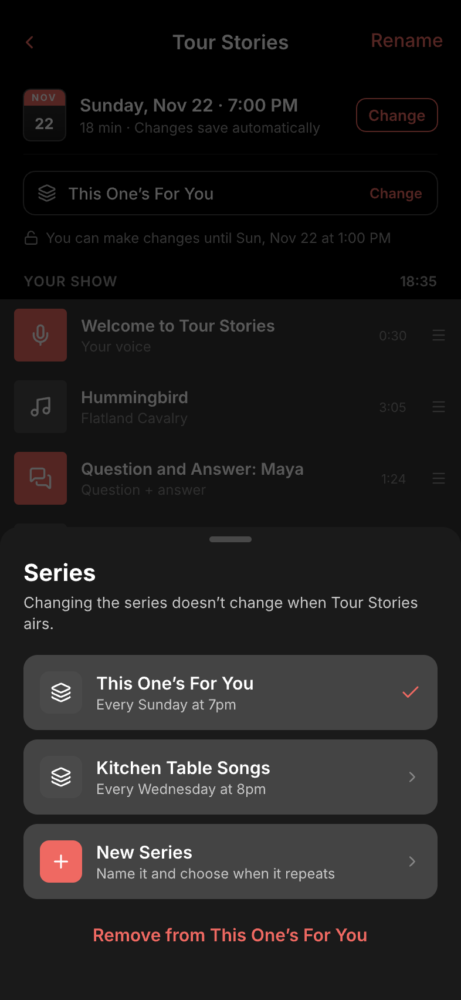
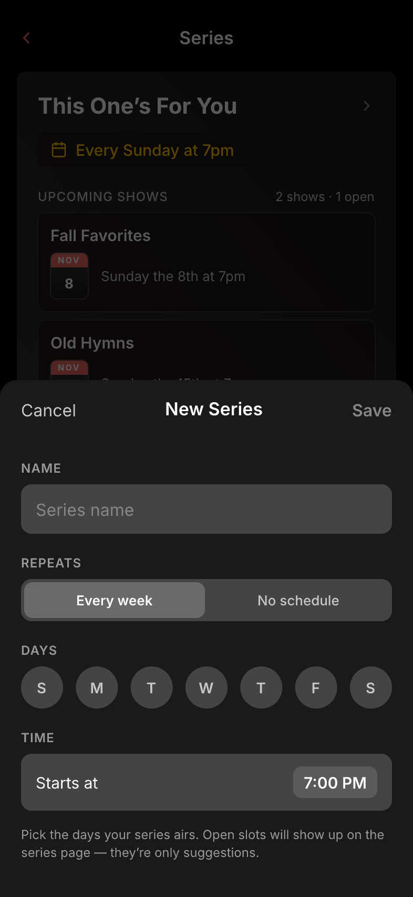

# 001 — Series picker

From a Show's builder, a station curator can put the Show in a Series, switch it to another Series, or take it out of its Series. They can also create a new Series on the spot — a name and an optional weekly day and time — and the Show joins it. Changing a Show's Series never changes when it airs.

**Words used here:** a **Show** is one recorded program (backend `Episode`); a **Series** is a named group of Shows with an optional weekly schedule (backend `Show`). A Show that isn't in a Series is **standalone**.

**Backend:** read at playola `develop` `f64cdea61`; this design needs no server change.

**List sizes:** a station has at most a few dozen Series; the picker scrolls.

**Builds on:** the Show builder already on `feature/recorded-shows`. Its Series row ("Add to a series", or the Series name with "Change") is on screen but does nothing yet; this design makes it work. This design adds no other entry points.

**Throughout:** loading uses the app's standard progress view; a failed load shows a toast; a failed action shows an alert with the server's message, after which the builder refreshes the Show. Times are in the station's time zone (Central for every station).

**A brand-new, unsaved Show:** "Record new show" on the Individual Shows page opens the builder with nothing saved yet (title "New Show", Draft, standalone); the builder already creates the Show on its first change. For this design:

- The builder's Series row reads "Add to a series · Optional" and opens the picker as for any standalone Show; the picker's subtitle names it "New Show".
- Opening the Series picker or New Series sheet, cancelling, or swiping either away creates nothing.
- Committing a Series choice — tapping a Series in the picker, or Save in New Series — creates the Show once, the same way the builder's other first changes do (a standalone Show titled "New Show"), then puts it in the chosen Series. From then on the builder is editing that saved Show.
- For New Series, the Series is created first, then the Show is created and joins it.
- If creating the Show fails, an alert shows the server's message and the builder stays unsaved. If the Show is created but joining fails, an alert shows the server's message and the builder shows the saved, standalone Show.

## Screens

### Series picker sheet — Add to a series

- **What it is:** a sheet over the Show builder listing the station's Series, plus "New Series".
- **Reached by:** tapping the builder's Series row while the Show is standalone ("Add to a series · Optional"). The row works in every builder state — Draft, Scheduled, Locked and Aired — with two exceptions it already has: it is disabled while the builder is still loading an existing Show, and for a Show that airs more than once (the builder is read-only for those: "This show airs more than once, so it can only be changed on the web."). It is also disabled while a Series change is saving, from the moment a Series choice is committed until the server confirms or refuses it.
- **State meaning:** the Show is standalone. Title "Add to a series"; subtitle "<Show> will show up on the series page."
- **Rows:** one per Series: its name and its schedule in words ("Every Sunday at 7pm"). A Series with no schedule says "No schedule"; one whose schedule the app can't read says "Custom schedule". The hidden one-time Series that hold standalone Shows are never listed. The last row is "New Series — Name it and choose when it repeats".
- **No Series yet (no mockup, described only):** the sheet shows only the "New Series" row.
- **Loading (no mockup, described only):** while the station's Series load, the sheet shows its title and subtitle above the app's standard progress view; the Series rows and "New Series" appear together once loaded.
- **Load failed (no mockup, described only):** a toast says the Series couldn't load; the sheet stays open showing only the "New Series" row (and, in the Change series state, "Remove from <Series>"). Closing and reopening the sheet retries.
- **Leaves by:**
  - Tapping a Series → the sheet closes at once and the change saves like the builder's other changes; the builder's Series row shows that Series' name once the server confirms (no optimistic update). The Show's air time does not change.
  - "New Series" → Series details sheet (New Series).
  - Swipe down → the sheet closes; nothing changes.

### Series picker sheet — Change series

- **What it is:** the same sheet when the Show is already in a Series.
- **Reached by:** tapping the builder's Series row (the Series name with "Change").
- **State meaning:** the Show is in a Series. Title "Series"; subtitle "Changing the series doesn't change when <Show> airs." The Show's current Series is checked. Below the rows: "Remove from <Series>".
- **Leaves by:**
  - Tapping another Series → the sheet closes at once; the builder's Series row shows the new name once the server confirms.
  - Tapping the checked (current) Series → the sheet closes; nothing is sent.
  - "New Series" → Series details sheet (New Series).
  - "Remove from <Series>" → the sheet closes at once; once the server confirms, the Show is standalone and the builder's Series row returns to "Add to a series".
  - Swipe down → the sheet closes; nothing changes.

### Series details sheet — New Series

- **What it is:** a sheet for naming a new Series and choosing when it repeats. (The mockup shows it over the Series list, where design 002 also opens it; opened from the picker it looks the same.)
- **Reached by:** "New Series" in the Series picker sheet.
- **State meaning:** creating a Series. Title "New Series", with Cancel and Save.
  - NAME: empty, placeholder "Series name".
  - REPEATS: "Every week" (selected) or "No schedule".
  - DAYS: S M T W T F S, none selected; tap to toggle. Hidden when "No schedule" is chosen.
  - TIME: "Starts at" with a time (7:00 PM to start), in the station's time zone (Central if the station's settings haven't loaded). Hidden when "No schedule" is chosen.
  - Note: "Pick the days your series airs. Open slots will show up on the series page — they're only suggestions."
  - Save is disabled (grey) while the name is empty or only spaces, or while "Every week" is chosen with no day selected. The name is trimmed before it is sent.
  - The time has no time-zone label (as in the mockup).
  - **Saving (no mockup, described only):** after Save is tapped, Save shows the app's standard progress view in its place and is disabled, and the sheet stays open until every step has finished.
- **Leaves by:**
  - Save → creates the Series, the Show joins it, and both sheets close, back on the builder with the new Series' name in its Series row.
  - Creating the Series fails → an alert shows the server's message; the New Series sheet stays open with everything as entered, so Save can be tapped again.
  - The Series is created but the Show can't join it (or an unsaved Show can't be created) → an alert shows the server's message; both sheets close and the builder shows the Show as the server has it. The new Series stays created and is listed in the picker.
  - Cancel or swipe down → back to the Series picker; nothing is created.

## Decisions

Each is also written into the screen it affects above.

1. **Unsaved Show:** opening or dismissing the Series sheets creates nothing; committing a Series choice creates the Show once (standalone "New Show"), then puts it in the Series. For New Series, the Series is created first.
2. **Picker loading:** title and subtitle above a progress view; rows and "New Series" appear together once loaded.
3. **Picker load failure:** toast; the sheet stays open with "New Series" (and "Remove from <Series>" when in a Series); reopening retries.
4. **Picking or removing:** the sheet closes at once; the builder's Series row changes once the server confirms (no optimistic update).
5. **Tapping the checked Series:** the sheet closes; nothing is sent.
6. **New Series saving:** Save becomes a disabled progress view; the sheet stays open until every step finishes.
7. **New Series failure:** if creating the Series fails, the sheet stays open with its input; if the Series is created but the Show can't be created or join it, both sheets close and the builder shows the Show as the server has it.
8. **Blank names:** a name of only spaces counts as empty; names are trimmed before sending.
9. **Time zone label:** none on New Series, as in the mockup.
10. **Builder states:** the Series row works in Draft, Scheduled, Locked and Aired; it stays disabled while an existing Show loads and for a Show that airs more than once (existing builder behaviour, kept).
11. **While a Series change saves:** the builder's Series row is disabled from the moment a Series choice is committed until the server confirms or refuses it, so the picker can't be reopened over a pending change.

## Done when

- [ ] Tapping the builder's Series row opens the picker in every builder state (Draft, Scheduled, Locked, Aired); the row stays disabled while an existing Show is loading, for a Show that airs more than once, and while a Series change is saving.
- [ ] A standalone Show's picker matches "Add to a series"; a Show in a Series' picker matches "Change series", with its Series checked and "Remove from <Series>".
- [ ] The picker lists every Series on the station and never a hidden one-time Series; each row shows its schedule in words, "No schedule", or "Custom schedule".
- [ ] Picking a Series puts the Show in it, closes the sheet, and the builder's Series row shows the Series name; the Show's air time is unchanged.
- [ ] "Remove from <Series>" makes the Show standalone and the builder's Series row reads "Add to a series"; the Show's air time is unchanged.
- [ ] New Series matches its mockup; Save stays disabled until it has a name and, for "Every week", at least one day; Days and Time disappear for "No schedule".
- [ ] Saving a New Series creates it, the Show joins it, and the builder shows its name; the new Series then appears in the picker.
- [ ] A Series made "Every week" on Tuesday and Thursday at 8:00 PM reads "Every Tuesday and Thursday at 8pm" in the picker, in Central time regardless of the phone's time zone.
- [ ] Cancel or swipe on either sheet changes nothing; tapping the checked Series closes the picker and sends nothing.
- [ ] While the Series list loads the picker shows a progress view; if it fails, a toast shows and the picker still offers "New Series" (and "Remove from <Series>" when in a Series).
- [ ] While New Series saves, Save is a disabled progress view; if creating the Series fails the sheet stays open with its input; if the Series is created but joining fails, both sheets close and the builder shows the Show as the server has it.
- [ ] On a brand-new unsaved Show, opening and dismissing the Series sheets creates nothing; committing a Series choice creates the Show once and puts it in that Series, and later changes edit that same Show.
- [ ] A server refusal shows an alert with the server's message, and the builder then shows the Show as the server has it.
