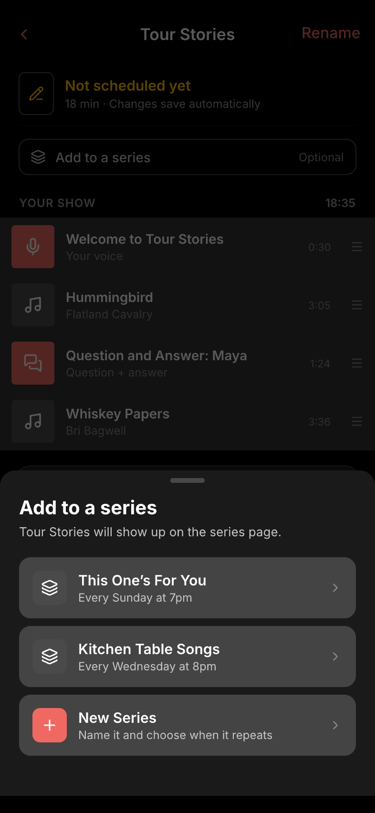
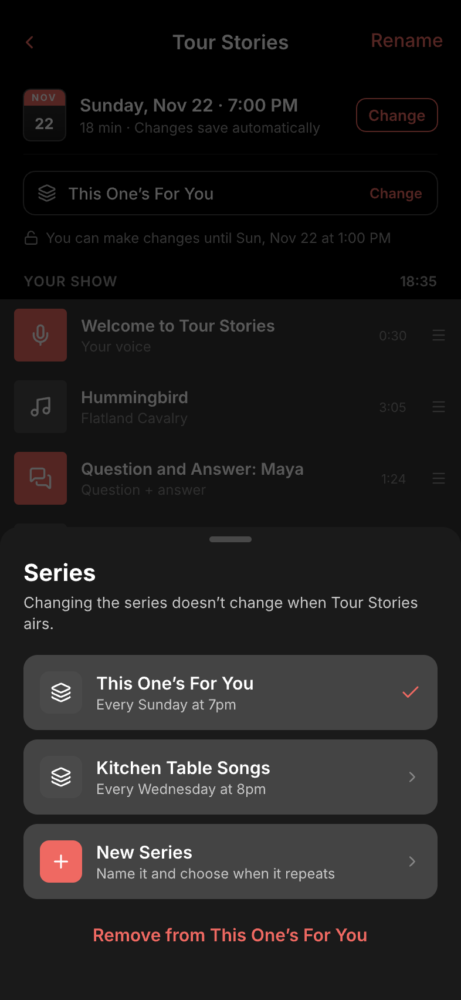
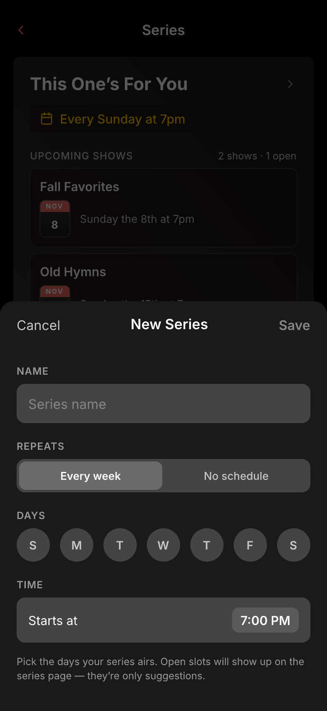

# 001 — Series picker

From a Show's builder, a station curator can put the Show in a Series, switch it to another Series, or take it out of its Series. They can also create a new Series on the spot — a name and an optional weekly day and time — and the Show joins it. Changing a Show's Series never changes when it airs.

**Words used here:** a **Show** is one recorded program (backend `Episode`); a **Series** is a named group of Shows with an optional weekly schedule (backend `Show`). A Show that isn't in a Series is **standalone**.

**Builds on:** the Show builder already on `feature/recorded-shows`. Its Series row ("Add to a series", or the Series name with "Change") is on screen but does nothing yet; this design makes it work. This design adds no other entry points.

**Throughout:** loading uses the app's standard progress view; a failed load shows a toast; a failed action shows an alert with the server's message, after which the builder refreshes the Show. Times are in the station's time zone (Central for every station).

## Screens

### Series picker sheet — Add to a series

- **What it is:** a sheet over the Show builder listing the station's Series, plus "New Series".
- **Reached by:** tapping the builder's Series row while the Show is standalone ("Add to a series · Optional"). The row works in every builder state — Draft, Scheduled and Locked.
- **State meaning:** the Show is standalone. Title "Add to a series"; subtitle "<Show> will show up on the series page."
- **Rows:** one per Series: its name and its schedule in words ("Every Sunday at 7pm"). A Series with no schedule says "No schedule"; one whose schedule the app can't read says "Custom schedule". The hidden one-time Series that hold standalone Shows are never listed. The last row is "New Series — Name it and choose when it repeats".
- **No Series yet (no mockup, described only):** the sheet shows only the "New Series" row.
- **Leaves by:**
  - Tapping a Series → the Show joins it; the sheet closes; the builder's Series row shows that Series' name. The Show's air time does not change.
  - "New Series" → Series details sheet (New Series).
  - Swipe down → the sheet closes; nothing changes.

### Series picker sheet — Change series

- **What it is:** the same sheet when the Show is already in a Series.
- **Reached by:** tapping the builder's Series row (the Series name with "Change").
- **State meaning:** the Show is in a Series. Title "Series"; subtitle "Changing the series doesn't change when <Show> airs." The Show's current Series is checked. Below the rows: "Remove from <Series>".
- **Leaves by:**
  - Tapping another Series → the Show moves to it; the sheet closes; the builder's Series row shows the new name.
  - "New Series" → Series details sheet (New Series).
  - "Remove from <Series>" → the Show becomes standalone; the sheet closes; the builder's Series row returns to "Add to a series".
  - Swipe down → the sheet closes; nothing changes.

### Series details sheet — New Series

- **What it is:** a sheet for naming a new Series and choosing when it repeats. (The mockup shows it over the Series list, where design 002 also opens it; opened from the picker it looks the same.)
- **Reached by:** "New Series" in the Series picker sheet.
- **State meaning:** creating a Series. Title "New Series", with Cancel and Save.
  - NAME: empty, placeholder "Series name".
  - REPEATS: "Every week" (selected) or "No schedule".
  - DAYS: S M T W T F S, none selected; tap to toggle. Hidden when "No schedule" is chosen.
  - TIME: "Starts at" with a time (7:00 PM to start), in the station's time zone. Hidden when "No schedule" is chosen.
  - Note: "Pick the days your series airs. Open slots will show up on the series page — they're only suggestions."
  - Save is disabled (grey) while the name is empty, or while "Every week" is chosen with no day selected.
- **Leaves by:**
  - Save → creates the Series, the Show joins it, and both sheets close, back on the builder with the new Series' name in its Series row. If either step fails, an alert shows the server's message; a Series that was created stays created.
  - Cancel or swipe down → back to the Series picker; nothing is created.

## Done when

- [ ] Tapping the builder's Series row opens the picker in every builder state (Draft, Scheduled, Locked).
- [ ] A standalone Show's picker matches "Add to a series"; a Show in a Series' picker matches "Change series", with its Series checked and "Remove from <Series>".
- [ ] The picker lists every Series on the station and never a hidden one-time Series; each row shows its schedule in words, "No schedule", or "Custom schedule".
- [ ] Picking a Series puts the Show in it, closes the sheet, and the builder's Series row shows the Series name; the Show's air time is unchanged.
- [ ] "Remove from <Series>" makes the Show standalone and the builder's Series row reads "Add to a series"; the Show's air time is unchanged.
- [ ] New Series matches its mockup; Save stays disabled until it has a name and, for "Every week", at least one day; Days and Time disappear for "No schedule".
- [ ] Saving a New Series creates it, the Show joins it, and the builder shows its name; the new Series then appears in the picker.
- [ ] A Series made "Every week" on Tuesday and Thursday at 8:00 PM reads "Every Tuesday and Thursday at 8pm" in the picker, in Central time regardless of the phone's time zone.
- [ ] Cancel or swipe on either sheet changes nothing.
- [ ] A server refusal shows an alert with the server's message, and the builder then shows the Show as the server has it.
