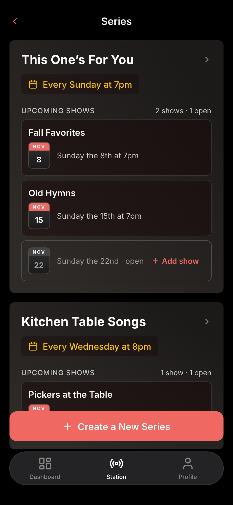
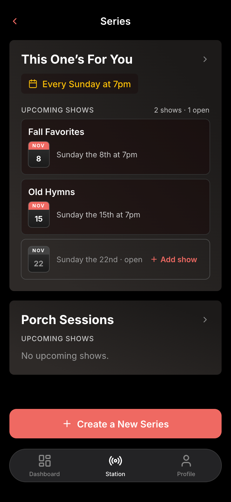
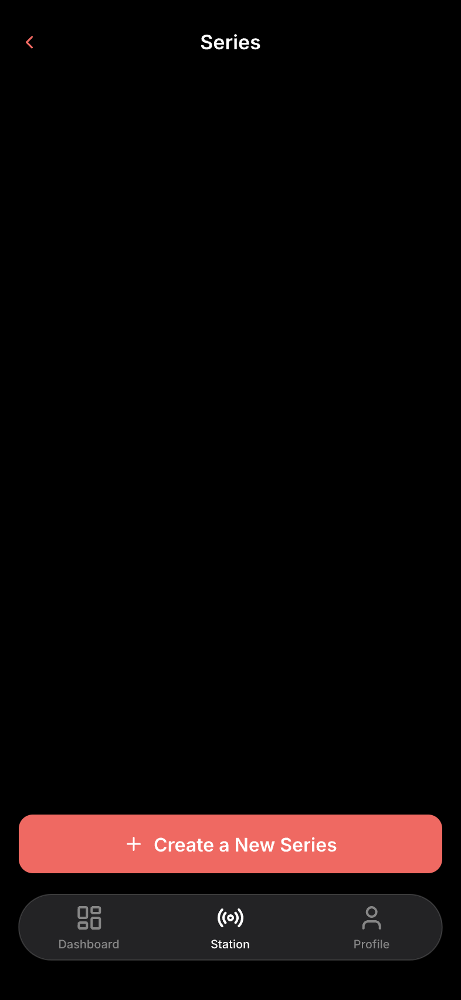
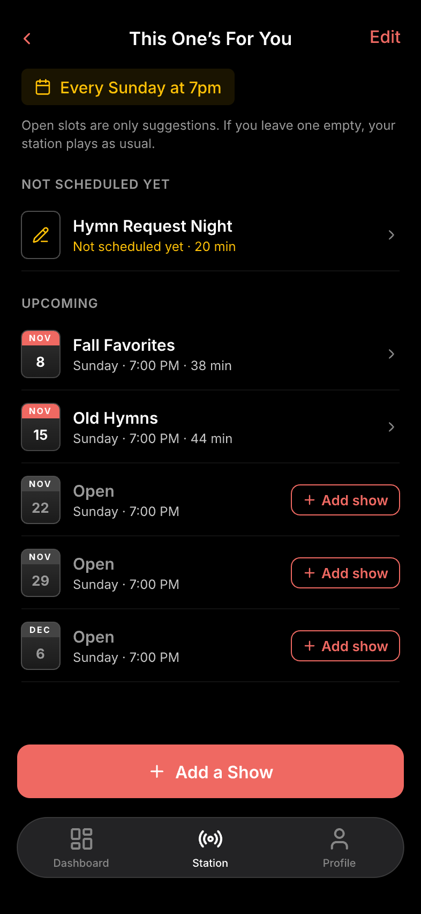
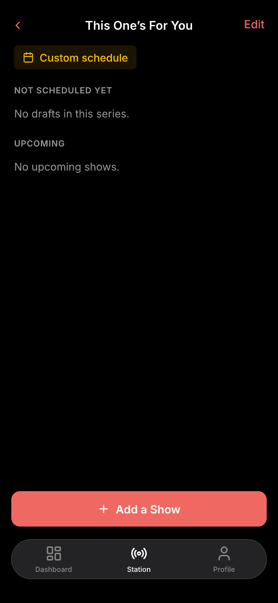
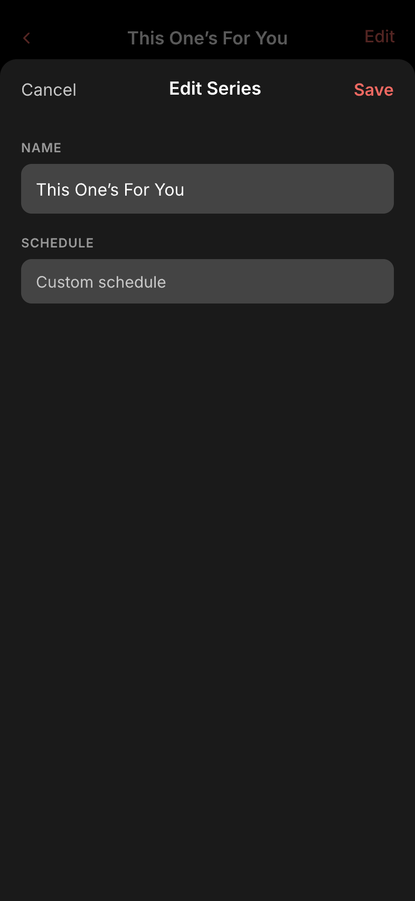
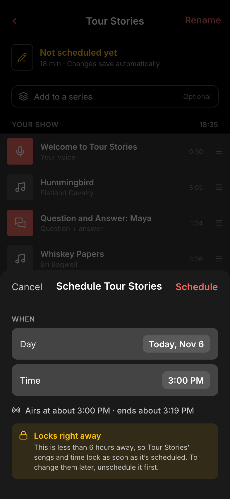

# 002 — Manage series

A station curator can open their Series from Upcoming → "Series", see each Series' upcoming Shows and open weekly slots, create a Series, and open a Series page to edit its name and schedule. From any open slot — or the page's "Add a Show" button — they can record a new Show for the Series or put one of their existing Shows into it. This completes the recorded-shows feature.

**Words used here:** a **Show** is one recorded program (backend `Episode`); a **Series** is a named group of Shows with an optional weekly schedule (backend `Show`). A **draft** is a Show that isn't scheduled. A **slot** is a time the Series' weekly schedule suggests; it is **open** when no Show on the station airs at that time. Slots are suggestions only — an empty slot plays the station's regular programming.

**Builds on:** design 001 (Series picker and the New Series sheet), the Show builder, and the Schedule sheet (PR #493). Upcoming's "Series" row is on screen but does nothing yet; this design makes it work.

**Throughout:** loading uses the app's standard progress view; a failed load shows a toast and keeps what was shown; a failed action shows an alert with the server's message, then the screen refreshes from the server. Times are in the station's time zone (Central for every station), not the phone's. Hidden one-time Series (which hold standalone Shows) never appear. Aired Shows are not listed anywhere in this design. Shows with more than one airing (made on the website) are never offered in the Add a show sheet.

**Schedules in words:** a weekly schedule reads like "Every Sunday at 7pm" or "Every Tuesday and Thursday at 8pm". A Series with no schedule has no schedule badge, no open slots, and no slots note. A Series whose schedule the app can't read shows "Custom schedule" and offers no open slots.

## Screens

### Series list — Default

- **What it is:** the station's Series as cards, titled "Series", in the server's order. Each card is styled like the listener app's Radio Shows card:
  - the Series name with a chevron;
  - the amber schedule badge ("Every Sunday at 7pm");
  - "UPCOMING SHOWS" with a count of what the card shows, singular or plural with a zero part dropped ("1 show", "2 shows · 1 open", "3 open");
  - the next 3 items in date order, mixing scheduled Shows and open slots:
    - a scheduled Show: a calendar tile, its name and "Sunday the 8th at 7pm";
    - an open slot: a grey calendar tile, "Sunday the 22nd · open" and "+ Add show".

  Drafts are not on the cards. A Show that airs more than once is listed at its next airing. A "Create a New Series" button sits at the bottom.
- **Reached by:** Upcoming → "Series".
- **State meaning:** the station has at least one Series.
- **Leaves by:**
  - A card's name → Series page.
  - A Show on a card → that Show's builder.
  - A slot's "+ Add show" → Add a show sheet for that slot.
  - "Create a New Series" → Series details sheet, New Series (see design 001's screenshot). Saving adds the new Series to the list.
  - Back → Upcoming.

### Series list — A card with nothing upcoming

- **State meaning:** a Series has no scheduled Shows and no open slots, which means it has no schedule or a "Custom schedule" and nothing is scheduled.
- **What it shows:** the card keeps its name, chevron and "UPCOMING SHOWS" heading. The count is hidden, and in place of rows is one line of grey text, "No upcoming shows." A Series with no schedule has no badge; a "Custom schedule" Series keeps its badge.
- **Leaves by:** the card's name → Series page. The rest of the list works as in the default state.

### Series list — Empty

- **State meaning:** the station has no Series yet.
- **What it shows:** the "Series" title and only the "Create a New Series" button — no cards.
- **Leaves by:** "Create a New Series" → New Series; saving shows the list with that Series' card. Back → Upcoming.

### Series page — Default

- **What it is:** one Series, titled with its name, with "Edit" at the top right. From top to bottom:
  - the amber schedule badge;
  - the note "Open slots are only suggestions. If you leave one empty, your station plays as usual.";
  - **NOT SCHEDULED YET:** this Series' drafts (pencil tile, name, "Not scheduled yet · 20 min"). A draft with no audio yet still appears, reading just "Not scheduled yet".
  - **UPCOMING:** this Series' scheduled Shows ("Sunday · 7:00 PM · 38 min") and its next 8 open slots within the next 52 weeks ("Open", "Sunday · 7:00 PM", "+ Add show"), together in date order. A Show that airs more than once is listed once, at its next airing.
  - an "Add a Show" button at the bottom.
- **Reached by:** Series list → a card's name.
- **State meaning:** always this state.
- **Leaves by:**
  - "Edit" → Series details sheet, Edit Series.
  - A Show (either section) → that Show's builder; coming back shows any changes.
  - A slot's "+ Add show" → Add a show sheet for that slot.
  - "Add a Show" → Add a show sheet with no slot. If the page's first load failed, it loads the station's scheduling details first; if that fails too, a toast shows and the sheet does not open.
  - Back → Series list.

### Series page — Empty sections

- **State meaning:** one or both sections have nothing to list. NOT SCHEDULED YET is empty when the Series has no drafts. UPCOMING is empty only when the Series has no scheduled Shows and no open slots, which means it has no schedule or a "Custom schedule". A weekly schedule always has open slots.
- **What it shows:** the section heading stays. Under it, in place of rows, is one line of grey text:
  - NOT SCHEDULED YET: "No drafts in this series."
  - UPCOMING: "No upcoming shows."

  The rest of the page, including "Add a Show", is unchanged.
- **Leaves by:** the same ways as the default state.

### Series details sheet — Edit Series

- **What it is:** the New Series sheet from design 001, titled "Edit Series" and filled in with the Series' name, Repeats, Days and Time. The note reads "Changing the schedule only changes your open slots. Shows that are already scheduled keep their times."
- **Reached by:** Series page → "Edit".
- **State meaning:** editing an existing Series. Save is disabled while the name is empty, or while "Every week" is chosen with no day selected. Choosing "No schedule" hides Days and Time and clears the schedule on Save.
- **Leaves by:**
  - Save → Save becomes a disabled progress view and Cancel, swipe and edits are blocked until it finishes. On success the sheet closes; the page shows the new name and schedule, and its open slots follow the new schedule. Shows already scheduled keep their times. If saving fails, an alert shows the server's message and the sheet stays open with its input.
  - Cancel or swipe down → closes; nothing changes.

### Series details sheet — Custom schedule

- **State meaning:** editing a Series whose schedule the app can't read.
- **What it shows:** the Edit Series sheet with the Name field editable. In place of Repeats, Days and Time is a read-only "Custom schedule".
- **Leaves by:** Save → renames the Series and leaves its schedule exactly as it was; saving and failure work as in Edit Series. Cancel or swipe down → nothing changes.

### Add a show sheet — From a slot

- **What it is:** a sheet titled "Add a show", with a subtitle naming the Series and the slot ("This One's For You · Sunday, Nov 22 at 7pm"). It contains:
  - a "Record a New Show — Start from scratch for this slot" row;
  - under "OR ADD ONE OF YOUR SHOWS", the Shows that can go in this slot, each with "Add":
    - drafts with at least one piece of audio ("Not scheduled yet · 18 min");
    - scheduled Shows that aren't locked ("Moves here from Sun, Nov 8 · 42 min").

  Drafts come first, in the server's order, then scheduled Shows by air time.

  Shows may be standalone or in another Series; adding one moves it into this Series. This Series' own Shows are not offered. Locked Shows are not offered (airing within 6 hours, on air, or aired), and neither are Shows with more than one airing.
- **Reached by:** a slot's "+ Add show" on the Series list or the Series page.
- **State meaning:** adding to a specific slot. While the list loads, the title, subtitle and "Record a New Show" show at once, with a progress view where the list goes.
- **Leaves by:**
  - "Record a New Show" → the builder for a new Show in this Series; its Schedule step offers this slot first. Nothing is saved until the first change in the builder.
  - "Add" on a draft → schedules it at the slot's time, then puts it in this Series; the sheet closes and the screen behind it refreshes.
  - "Add" on a scheduled Show → moves it to the slot's time, then puts it in this Series; the sheet closes and the screen refreshes.
  - While an "Add" is working, that row's "Add" is a progress view and the other "Add" buttons and "Record a New Show" are disabled. The sheet stays open until every step has finished, then closes; any alert below shows after it has closed.
  - "Add" when the slot is less than 6 hours away → the Schedule sheet set to that slot replaces this sheet (next screen); scheduling there finishes the add.
  - If scheduling or moving is refused, an alert titled "Couldn't Add" ("Show Locked" when the server says the Show is locked) shows the server's message, and the Show is unchanged.
  - If the Show is scheduled but putting it in the Series fails, an alert titled "Scheduled, but Not in <Series>" shows the server's message. The Show stays scheduled at the slot's time, outside this Series; the curator can fix that from the builder's Series row.
  - Swipe down → closes; nothing changes.

### Add a show sheet — No slot (no mockup, described only)

- **State meaning:** opened from the Series page's "Add a Show" button, with no slot.
- **What it shows:** the same sheet. The subtitle names only the Series. "Record a New Show" is followed by the same list of Shows, except that scheduled Shows show their own air time and length ("Sun, Nov 8 · 42 min") instead of "Moves here from …".
- **Leaves by:**
  - "Record a New Show" → the builder for a new Show in this Series; its time is picked in the Schedule step.
  - "Add" → puts the Show in this Series without changing its air time (a draft stays a draft); the sheet closes and the page refreshes. "Add" works as from a slot; a refusal shows "Couldn't Add" with the server's message.
  - Swipe down → closes.

### Add a show sheet — Nothing to offer (no mockup, described only)

- **State meaning:** no Show qualifies for the list, either from a slot or with no slot.
- **What it shows:** the title, subtitle and "Record a New Show" only. The "OR ADD ONE OF YOUR SHOWS" heading is hidden. The sheet also looks like this, after a toast, when its list fails to load.
- **Leaves by:** "Record a New Show" or swipe down, as above.

### Schedule sheet — Locks right away (opened from Add a show)

- **What it is:** the existing Schedule sheet (PR #493). It looks the same; the mockup happens to show it over the builder. One change, wherever it is used: while it saves, Cancel is disabled and swipe-down is blocked, so it stays open until every step has finished.
- **Reached by:** "Add" in the Add a show sheet when the slot is less than 6 hours away. It replaces the Add a show sheet rather than stacking on it, and opens set to the slot's day and time, so the "Locks right away" note shows before anything is scheduled.
- **State meaning:** the picked time is less than 6 hours away, so the Show's content and time lock as soon as it is scheduled.
- **Leaves by:**
  - "Schedule" → schedules (or moves) the Show, then puts it in the Series, as in the slot flow above; the sheet closes.
  - If scheduling is refused (including "locked" or "overlaps another show"), the error shows inside this sheet, as the Schedule sheet already does, rather than as an alert after closing. The sheet stays open so the curator can pick another time or Cancel, and the screen behind refreshes. If scheduling succeeds but putting it in the Series fails, the sheet closes and the "Scheduled, but Not in <Series>" alert shows after it.
  - Cancel or swipe down (before "Schedule") → closes; nothing is scheduled.

## Decisions

Each is also written into the screen it affects above.

1. **Card order:** Series appear in the server's order.
2. **A card with nothing upcoming:** it keeps its "UPCOMING SHOWS" heading, hides the count, and shows "No upcoming shows." in place of rows.
3. **Count wording:** singular or plural, with a zero part dropped: "1 show", "2 shows · 1 open", "3 open".
4. **Add a show loading and failure:** the title, subtitle and "Record a New Show" show at once, with a progress view where the list goes. If the list fails to load, a toast shows and the sheet looks like "Nothing to offer".
5. **Tapping "Add":** that row's "Add" becomes a progress view and the other "Add" buttons and "Record a New Show" are disabled. The sheet stays open until every step has finished, then closes; any refusal's alert shows after it has closed, and the screen behind refreshes.
6. **A slot less than 6 hours away:** the Schedule sheet replaces the Add a show sheet rather than stacking on it. The Schedule sheet (PR #493) is unchanged except that, everywhere it's used (the builder too), Cancel and swipe-down are blocked while it saves.
7. **Edit Series saving and failure:** the same as New Series in design 001. Save becomes a disabled progress view and Cancel, swipe and edits are blocked until it finishes. If saving fails, an alert shows the server's message and the sheet stays open with its input; on success the sheet closes.
8. **Shows with more than one airing:** they are listed on the card and the Series page at their next airing, and drop off once every airing has aired. They are still never offered in the Add a show sheet.
9. **How far ahead open slots are looked for:** 52 weeks, on the cards and the Series page. A weekly Series whose every time in that window is taken shows fewer or no open slots; with no Shows either, its card and UPCOMING section show "No upcoming shows."

## Done when

- [ ] Upcoming → "Series" opens the Series list, matching its mockup. With no Series it shows only "Create a New Series".
- [ ] Each card shows its next 3 items (scheduled Shows and open slots in date order) and a count that matches them ("1 show", "2 shows · 1 open", "3 open"); a card with nothing upcoming shows "No upcoming shows." and no count. A slot already taken by any Show on the station is never shown as open.
- [ ] A Show that airs more than once is listed once, at its next airing, on its card and its Series page.
- [ ] A Series with no schedule shows no badge, no slots and no slots note. An unreadable schedule shows "Custom schedule" and no slots.
- [ ] Open slots and times are correct in Central time regardless of the phone's time zone, including across both daylight-saving changes.
- [ ] A card's name opens the Series page, matching its mockup: drafts under NOT SCHEDULED YET; scheduled Shows plus the next 8 open slots (looking up to 52 weeks ahead) under UPCOMING, in date order.
- [ ] An empty section keeps its heading and shows its message ("No drafts in this series." / "No upcoming shows.") in place of rows.
- [ ] Creating a Series from the list adds its card. Editing a Series' name or schedule updates the page and its open slots, and leaves already-scheduled Shows' times alone.
- [ ] Edit Series' Save is disabled while the name is empty, or while "Every week" has no day. A "Custom schedule" Series can be renamed without changing its schedule.
- [ ] While Edit Series saves, Save is a disabled progress view; if saving fails, an alert shows the server's message and the sheet stays open with its input.
- [ ] While the Add a show list loads, "Record a New Show" is already there with a progress view below it; if the list fails to load, a toast shows and the sheet offers only "Record a New Show".
- [ ] While an "Add" works, its row shows a progress view and the other "Add" buttons and "Record a New Show" are disabled; the sheet closes only when every step has finished, and any refusal's alert shows after it closes.
- [ ] From a slot, adding a draft schedules it at that time and puts it in the Series; adding a scheduled Show moves it there and puts it in the Series. Both then show in that slot on the page.
- [ ] If joining the Series fails after scheduling succeeds, an alert says so and the Show stays scheduled at the slot's time.
- [ ] A slot less than 6 hours away opens the Schedule sheet at that slot with "Locks right away" showing.
- [ ] The Add a show sheet never offers locked Shows, Shows with more than one airing, drafts without audio, or this Series' own Shows.
- [ ] "Add a Show" with no slot puts the chosen Show in the Series without changing its time.
- [ ] "Record a New Show" from a slot opens the builder for a new Show in the Series, with the slot offered first in its Schedule step. Backing out without changes leaves nothing behind.
